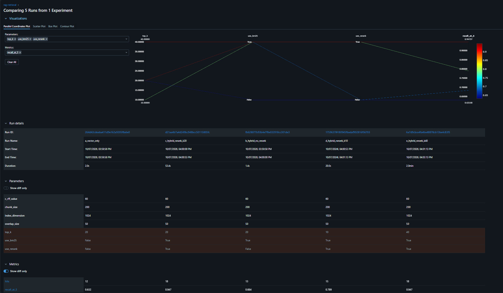

# RAG v3 — Measured, Eval-Driven Document Q&A

A multi-user Retrieval-Augmented Generation (RAG) service built with an eval-first discipline:
every retrieval change is judged by a number on a hand-written eval set, never on vibes. Users
register, upload documents, and chat with them in a browser UI; conversations are stored in
Postgres and follow-up questions work. It runs as a FastAPI service in Docker, stores documents
in Postgres + pgvector, and tracks every retrieval experiment in MLflow. This README also records
what didn't work and what is still open.

## Architecture

```
upload:  file -> load_document -> chunk (200 tokens, 50 overlap) -> embed (bge-large, 1024-d)
              -> Postgres (chunks + pgvector), per user_id, duplicate uploads skipped (SHA-256)
ask:     question (+ last 3 turns of the chat, loaded by the server)
              -> rewrite follow-ups into a standalone question (LLM call, skipped for a new chat)
              -> embed -> BM25 over the user's chunks + pgvector search
              -> RRF fusion -> cross-encoder rerank -> top 5 chunks -> LLM answer
              -> user + assistant messages saved to the conversation
eval:    retrieval recall@5 through the same Postgres code path; every config logged to MLflow
```

### Code map

- `src/api.py` — FastAPI app and routes (below).
- `src/auth.py` — bcrypt password hashing, JWT creation and the `get_current_user` dependency.
- `src/db.py` — Postgres access: schema creation at startup, connection pool, per-user pgvector
  search, documents, and the conversation/message helpers.
- `src/pipelines.py` — orchestration: upload processing, `answer_question` (rewrite, then
  `ask_question_phase1` retrieval with `use_bm25` / `use_rerank` / `top_k` switches, then
  `ask_question_phase2` LLM), and the recall@5 eval loop.
- `src/embedder.py` — dense embeddings (`BAAI/bge-large-en-v1.5`), BM25, Reciprocal Rank Fusion,
  cross-encoder reranker (`BAAI/bge-reranker-base`).
- `src/model.py` — LLM layer: `LLM_BACKEND` = `ollama` | `claude` | `gemini`. Gemini calls (answer
  and question rewrite) retry each model with a growing pause, then fall back to the next model.
- `src/static/index.html` — the single-page UI (no framework): sign in / create account, upload,
  document picker, chat, conversation sidebar. Served by FastAPI at `/`.
- `src/track_eval.py` — runs the retrieval grid and logs each config as an MLflow run.
- `src/timing.py` — per-stage timings written to the container log (logger `rag.timing`).
- `Dockerfile` + `docker-compose.yml` — `api` (port 8003) and `db` (`pgvector/pgvector:pg16`)
  with persistent volumes for Postgres data and the HuggingFace model cache.

### Routes

| Route | What it does |
|---|---|
| `POST /register`, `POST /login` | username + password (8+ chars, bcrypt-hashed); login returns a JWT |
| `POST /upload` | add a document for the signed-in user |
| `GET /documents` | the user's own document list |
| `POST /ask` | `question`, optional `documents_id` (repeat per ticked document), optional `conversation_id` |
| `GET /conversations` | the user's chats, most recently active first |
| `GET /conversations/{id}` | one chat's messages (with sources) |
| `DELETE /conversations/{id}` | delete a chat and its messages |
| `GET /` | the web UI |

Every route except `/`, `/register` and `/login` needs `Authorization: Bearer <token>`.
The `user_id` comes only from the signed token, never from the request body.

### Data model

`users`, `documents`, `chunks` (with `vector(1024)`), `conversations`, `messages`. Messages
reference their conversation with `ON DELETE CASCADE` and are indexed on
`(conversation_id, id)`. Assistant rows store the source line and the retrieved passages as
`JSONB`; user rows store which documents were ticked (`INTEGER[]`).

## Conversations and memory

LLMs are stateless, so "memory" means putting the right text in front of the model.

1. **The server owns the history.** The browser sends only a `conversation_id`. The server
   loads the last 3 turns (6 messages, role + content) from Postgres, so a client can't forge
   history.
2. **Query rewriting.** Retrieval only sees the question text, so "and what is its number?"
   would search for nothing useful. For a follow-up, one small structured LLM call rewrites it
   into a standalone question ("What is the invoice number?"). A new chat skips this call.
3. **The rewritten question is used for everything downstream**: BM25, vector search, rerank
   and the answer prompt. The answer prompt does not get the history. The UI still shows the
   user's original wording.
4. **Ownership.** Another user's `conversation_id` behaves exactly like one that doesn't exist
   (404), so ids can't be probed.
5. **Failure behavior is a decision, not an accident.** If the rewrite (or answer) LLM fails
   after its retries, `/ask` returns 503 with a clean message and saves nothing. I chose this
   over silently searching with the unresolved follow-up, which would give a poor answer.
6. **What gets saved:** the user message and the assistant message, after the answer is ready.
   The "no files uploaded" reply and failed requests are not saved.

Alternatives I compared and didn't build: multi-query expansion with RRF, and agentic
retrieval (the LLM calls a search tool). Rewriting was the cheapest fit for this pipeline.

## Status

| Step | Status |
|---|---|
| FastAPI `/upload` + `/ask` | Done |
| Docker + compose, volumes, persistence verified | Done |
| Postgres + pgvector replaces FAISS + JSON files (pool, duplicate skip, per-user isolation) | Done |
| Provider-agnostic LLM switch with retry/fallback | Done |
| Stage timings in the container log | Done |
| Retrieval eval through Postgres + MLflow experiment tracking | Done |
| Auth (register, login, JWT) and per-user isolation | Done |
| Web UI: login, upload, document picker, chat | Done |
| Conversations + chat memory (sidebar, follow-up questions) | Done |
| Cloud deployment (Azure) | Not started (budget-blocked, prep next) |
| GPU passthrough for the embedder/reranker | Deferred (not useful for a CPU deployment) |
| CI-gated eval | Not started |

## Results

### Retrieval quality (MLflow, Postgres + pgvector, 19 answerable questions)

Eval set: `src/test_sets/eval_set_one.json`, hand-written from a nursing-home fall-risk
research paper. 22 questions, 3 are unanswerable and skipped, leaving 19. recall@5 counts a
question as a hit when every required gold snippet appears in the top-5 retrieved chunks.
Each config is one run (`src/track_eval.py`).

| Config | recall@5 | Hits |
|---|---|---|
| a) vector only, top_k 20 | 63.2% | 12/19 |
| b) vector + BM25 (RRF), no rerank, top_k 20 | 68.4% | 13/19 |
| c) vector + BM25 + rerank, top_k 20 (**current**) | **94.7%** | 18/19 |
| d) vector + BM25 + rerank, top_k 10 | 78.9% | 15/19 |
| e) vector + BM25 + rerank, top_k 40 | 94.7% | 18/19 |



- Reranking is the big lever: +5 questions over b.
- BM25 over vector-only is +1 question, within noise on this set.
- Widening the candidate pool from 20 to 40 adds nothing; shrinking it to 10 costs 3 questions.
- Re-running the whole grid gave identical numbers, so retrieval is deterministic.
- **Regression check after adding conversations and memory:** re-run on 2026-10-23, config c
  still 94.7% (18/19), so the `/ask` changes did not touch retrieval quality.
- Caveats: 19 questions (1 question ~ 5 points), one document, one run per config. Read the
  result as "about 90-95% recall@5 on a 19-question hand-written set", not a precise figure.
- The single miss in config c: "Why does the review argue that current fall risk assessment
  tools are insufficient, and what direction does it recommend for future development?"
  (a multi-chunk "why / what direction" question). Not yet investigated.

*Earlier baseline (in-memory FAISS, 22 questions including the 3 unanswerable ones): hit@5 =
90.9% (20/22). Different denominator, so it is not a like-for-like comparison.*

### Latency per `/ask` query

Measured 2026-10-06, Docker Compose stack on a Windows 11 host, CPU-only embedder and
reranker, one run each (not averaged).

| Stage | Local qwen3.5:9b (Ollama) | Hosted Gemini flash |
|---|---|---|
| rerank (CPU cross-encoder) | 1.2 s | 1.7 s |
| vector search (pgvector) | ~0 s | 0.007 s |
| LLM call | 57.7 s | 5.5 s |
| total | ~59 s | 7.8 s |

The LLM call dominates end-to-end latency; retrieval is cheap. Uploading an 87-chunk document
takes ~63 s on CPU (embedding), a one-time cost per document that I accepted for v1; a smaller
embedding model or background embedding would reduce it. Hosted Gemini sends retrieved chunks
to Google; Ollama remains the private/local option.

A single later run on a hosted Gemini model (2026-10-20): embed 0.5 s, rerank 2.4 s, LLM 12.4 s,
total 15.4 s. LLM latency varies a lot run to run. The rewrite step adds one more LLM call to
follow-up questions only; its added latency has not been measured yet.

### Generation quality (SQuAD v2, 100 Q, earlier pipeline)

| Backend | Faithfulness | Accuracy | Hallucinated-on-impossible | False-refusal-on-answerable |
|---|---|---|---|---|
| qwen3-coder-30b | 88% | ~67% | 23/55 (42%, ~7% once judge/label noise is separated out) | 6/45 (13%) |
| Claude Sonnet 5 | 96% | 76% | 11/55 (20%, ~7% real fabrication after the same correction) | 9/45 (20%) |

Measured before the move to Postgres and not re-run since. SQuAD was used to debug the
harness, not to tune retrieval.

## Testing

Besides the retrieval eval, the conversations feature was tested by hand against a public
benchmark document (llmware `rag_instruct_benchmark_tester`, 200 passages loaded as one file):

- **Answers and refusals:** an answerable question returned the right value with its source;
  a question whose answer isn't in the document was refused.
- **Memory:** a follow-up with a pronoun ("and what is its number?") resolved correctly, both in
  the UI and through the API.
- **Persistence:** refresh and hard-refresh keep the user signed in and reopen the chat;
  sign-out then sign-in lists the chats.
- **Isolation:** a second account sees no chats or documents of the first; its `conversation_id`
  requests return 404; no token returns 401; a made-up id returns 404.
- **Document selection:** with only a second document ticked, a question about the first was
  refused; a question about the second was answered.
- **Edge cases:** empty and whitespace-only input, deleting the open chat, two tabs with a
  chat deleted in one, long multi-paragraph answers, and a real LLM rate-limit (Gemini free-tier
  429) which produced the clean 503 and saved nothing.

## Key findings

- **A metric bug can look exactly like a real result.** A whitespace mismatch between
  PDF-extracted text and hand-typed snippets gave a 0% hit rate, then a strict substring
  match still under-counted (hyphenation, curly quotes). The fix was a normalized comparison
  (`snippets_hit`: lowercase letters and digits only, both sides). Same retrieval, hit@5 rose
  from ~27-36% to 81.8% at the time.
- **An unbounded candidate list is not "hit@5".** With the reranker off, an early eval passed
  the whole fused list to the hit check and reported 100%. Truncated to 5, it was 72.7%.
- **"Hallucination on impossible questions" needed splitting by faithfulness.** Most such
  answers were grounded in the context and only disagreed with an overly strict label; the
  naive metric overstated hallucination ~3x.
- **Moving state into Postgres broke the eval harness** (it read JSON files from disk). It now
  reads through the psycopg pool and uses the same retrieval code as the API.
- **Relative paths depend on where you launch from.** Running the eval from `src/` created a
  second `mlflow.db` there, and running it from the root couldn't find the eval set. The
  eval-set path is now anchored on the file; the MLflow store still follows the working
  directory, so run from the repo root.
- **UI state vs server state.** A new chat created while the user clicked another chat didn't
  appear in the sidebar until a reload: the refresh was guarded by "am I still on the chat I
  asked in?". Fix: always refresh the list when the server created a chat, and guard only the
  decision to switch to it.
- **Free-tier LLM quotas are a real failure mode.** The Gemini free tier (20 requests per day per
  model) ran out during testing. The answer step already fell back across models; the rewrite
  step didn't, so every follow-up failed. It now uses the same retry and fallback.
- Two earlier conclusions (a "31.6% reranker-on-everything" result and "chunk boundaries
  destroy ~25% of misses") were drawn with the under-counting matcher and are withdrawn.
- Contextual Retrieval (LLM-written per-chunk blurbs) was implemented earlier, but its effect
  on recall was never cleanly measured.

## Limitations

- **Tiny eval set, single document.** 19 answerable questions on one academic paper; results
  may not generalize to other document types. Follow-up retrieval with and without the rewrite
  step has not been evaluated.
- **Chunking is naive.** Fixed 200-token windows with 50 overlap, no sentence or paragraph
  awareness. Its measured impact is unknown.
- **PDF and DOCX extraction artifacts.** Line-break hyphenation hurts BM25 tokenization. DOCX
  table text is appended after the paragraphs, flattened, and merged cells can repeat, so a
  label in a table (e.g. "Week 9") can end up far from the entries it describes.
- **CPU-only embedder and reranker** in the container; uploads are slow (~63 s for 87 chunks).
- **Memory is query rewriting only.** The answer prompt doesn't see the chat, history is capped
  by turn count (3) but not by length, and a rewrite that is wrong sends retrieval the wrong way.
- **One request at a time in the UI.** Send is disabled while any answer is loading, and tabs
  don't sync live (a chat created in one tab shows in another after a refresh).
- **A failed LLM call fails the request** (503) rather than degrading; chosen on purpose.
- **Latency numbers are single runs** and the exact Gemini model id was not recorded.
- **BM25 candidate count is fixed** by `hybdrid_embedding_top_k` in `config.py`; the `top_k`
  switch only changes the vector search and the fused list.
- **LLM-judge noise was never quantified**, and generation eval has not been re-run against
  the real document or the Postgres pipeline.
- **Security hardening before a public deploy:** the compose file publishes Postgres on port
  5432, the app connects as the `postgres` superuser, and secrets live in a local `.env`.
  There is no rate limiting, and the delete confirmation uses the browser's built-in dialog.
- Not yet deployed; no CI gate.

## Setup and running

1. Create your config file from the template, then fill it in:

   ```bash
   cp .env.example .env             # Windows PowerShell: Copy-Item .env.example .env
   ```

   | Variable | Needed | Meaning |
   |---|---|---|
   | `POSTGRES_PASSWORD` | always | password for the Postgres container and the app's connection |
   | `JWT_SECRET` | always | long random string that signs login tokens (the app won't start without it) |
   | `LLM_BACKEND` | always | `gemini`, `claude` or `ollama` (defaults to `ollama` if unset) |
   | `GEMINI_API_KEY`, `GEMINI_MODELS` | if `gemini` | key and a comma-separated list of models, tried in order |
   | `ANTHROPIC_API_KEY` (`CLAUDE_MODEL` optional) | if `claude` | key for the Claude backend |
   | `OLLAMA_BASE_URL` | if `ollama` | where Ollama listens; inside Docker use `http://host.docker.internal:11434/v1` |

   `POSTGRES_HOST` is set to `db` by `docker-compose.yml`; you don't put it in `.env`.

2. Start everything (the first build downloads the embedding and reranker models, so it takes a while):

   ```bash
   docker compose up --build        # UI + API on http://127.0.0.1:8003, Postgres on 5432
   ```

3. Open http://127.0.0.1:8003, create an account, upload a document, and ask a question.

Use `127.0.0.1`, not `localhost`, on Windows (IPv6 resolution hangs). See `src/config.py` for the
chunking and retrieval parameters. The local Ollama option needs Ollama running on your machine
with the `qwen3.5:9b` model pulled.

Run the retrieval experiments from the repo root, with the eval document uploaded under a
dedicated eval account (pass that account's `user_id` in `src/track_eval.py`):

```bash
python src/track_eval.py         # logs the a-e grid to MLflow
mlflow ui --port 5000            # run from the same directory; open http://127.0.0.1:5000
```

## Roadmap

1. Deployment prep: stop publishing the Postgres port, a least-privilege database role,
   secrets from the cloud's secret store, a hosted LLM backend (the local Ollama option can't
   be reached from the cloud).
2. Cloud deployment (Azure): container registry, container app, managed Postgres.
3. Inspect the one missed eval question (retrieval problem or multi-chunk question?).
4. Follow-up retrieval eval (rewrite on vs off) logged to MLflow.
5. Polish: in-app delete dialog, per-chat pending state, DOCX table handling.
6. Optional: GPU passthrough for the embedder and reranker as a Docker-for-ML exercise.
